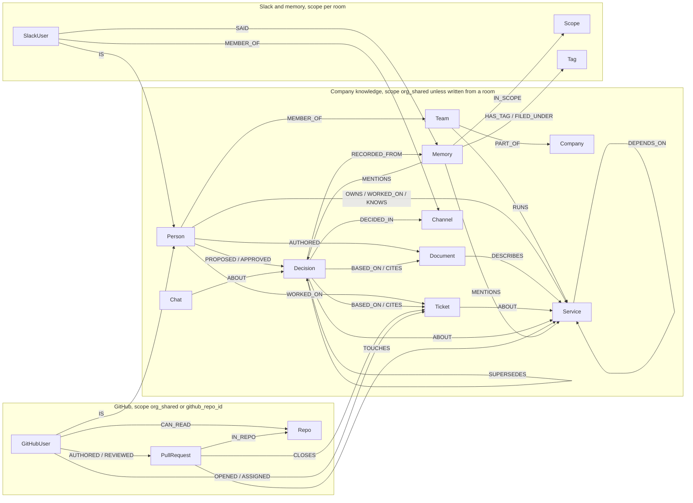

# Company Brain

[](https://github.com/codesensei-tushar/graph_hacks/actions/workflows/deploy.yml)

Hackathon project for Graph Hacks track 03. FalkorDB holds how a company is connected. An agent answers from that graph and shows the path behind each answer.

Ask it in Slack and it answers from the graph, then prints the edges it walked:

| You ask | It walks |
| --- | --- |
| Who owns billing, and who else has worked on it? | `Person -[OWNS]-> Service`, then past work, pull requests and reviews |
| Why did we move the memory layer off Postgres? | `Person -[PROPOSED]-> Decision -[CITES]-> Document`, and the chat it came from |
| What breaks if auth goes down? | `Service -[DEPENDS_ON]-> Service`, to a depth you choose |
| A billing bug just landed. Who should look at it? | Writes the ticket after you approve, then ranks the people connected to that service |

If the thing you named is not in the graph, it says so and offers the nearest matches. It never guesses.

- What to build: [docs/PROBLEM.md](docs/PROBLEM.md)
- Hackathon strategy (rules, judges, competitors, build order): [docs/STRATEGY.md](docs/STRATEGY.md)
- Blog post outline: [docs/BLOG.md](docs/BLOG.md)
- Pitch deck, slide by slide: [docs/PITCH.md](docs/PITCH.md)
- How to run the graph: [docs/SETUP.md](docs/SETUP.md)
- Slack app and permissions: [docs/SLACK.md](docs/SLACK.md)
- GitHub App ingestion: [docs/GITHUB.md](docs/GITHUB.md)
- What is built and what is next: [docs/SLACK.md#what-is-next](docs/SLACK.md#what-is-next)
- Production deploy, CI/CD and operations: [docs/DEPLOY.md](docs/DEPLOY.md)
- Replay the synthetic company for a demo or a test: [docs/SETUP.md](docs/SETUP.md#replay-the-synthetic-company)

AI assistance: parts of this project were written with Claude Code (Anthropic), including the production infrastructure, deploy pipeline and their docs.

```bash
docker compose up -d
python -m venv .venv && source .venv/bin/activate
pip install -r requirements.txt
cp .env.example .env
python scripts/seed_graph.py
uvicorn src.main:app --reload
```

To see the seven demo answers with no Slack app and no model key, run the synthetic company through the real routes against a local fake of the Slack API. It seeds the fictional Quillfern into a graph of its own and prints every reply with the edges it walked:

```bash
python scripts/replay_workspace.py --graph company_demo
```

That is the complete local setup the rules accept in place of a live deployment: Docker, Python 3.11 or newer, and the two commands above. Verified from a clean clone on Python 3.13 with only `requirements.txt` installed.

The interface is Slack. Create the app from [`slack_app/manifest.yaml`](slack_app/manifest.yaml) and follow [docs/SLACK.md](docs/SLACK.md). The same read-only catalogue is also a page at [http://localhost:8000/](http://localhost:8000/), which draws the path behind each answer and runs the same questions with the graph switched off. Health check: [http://localhost:8000/api/health](http://localhost:8000/api/health). Graph browser: [http://localhost:3000](http://localhost:3000).

## Graph data model

A `Service` node is anything a team owns: a service, a system, a process, a product, an account, a policy or a playbook. Its `kind` changes only how replies read ("the Renewals process stalls", "the Refund policy is owned by ...").



One FalkorDB graph (`company`) holds everything: the seeded company, what Slack and GitHub add at runtime, every memory, and who may read what. Nodes carry `id` and `name`; the tool answers cite them. The Cypher that reads and writes each part is listed in the next section.

**Scopes.** A node written from Slack or GitHub carries `scope`: `org_shared` (public channels, public repos), `slack_channel_<id>` (one private channel or group DM), `user_<slack id>` (one person's DMs with the bot), or `github_repo_<id>` (one private repo). Seeded nodes have no `scope` and count as `org_shared`. Every read filters `coalesce(n.scope, 'org_shared') IN $scopes`, where `$scopes` is the asker's read set.

**Company knowledge** (`src/seed/`, extended by Slack commands and GitHub webhooks):

| Label | Properties | Edges out |
| --- | --- | --- |
| `Company` | `id`, `name` | |
| `Team` | `id`, `name` | `-[:PART_OF]->(Company)`, `-[:RUNS]->(Service)` |
| `Person` | `id`, `name`, `role`, `email`, `github`, `org_member`, `provisioned_by`, `created_at` | `-[:MEMBER_OF]->(Team)`, `-[:OWNS\|WORKED_ON\|KNOWS]->(Service)`, `-[:WORKED_ON]->(Ticket)`, `-[:AUTHORED]->(Document\|Chat)`, `-[:PROPOSED\|APPROVED]->(Decision)` |
| `Service` | `id`, `name`, `kind` (`service`, `system`, `process`, `product`, `account`, `policy` or `playbook`; absent reads as `service`), `aliases`, `summary`, `paths` (repo prefixes a pull request can touch) | `-[:DEPENDS_ON]->(Service)`: this process or product stops if that system goes down. An `account` takes no `DEPENDS_ON` edges and never appears in a blast radius or a load-bearing ranking. |
| `Document` | `id`, `name`, `summary` | `-[:DESCRIBES]->(Service)` |
| `Ticket` | `id`, `name`, `title`, `summary`, `scope`; from GitHub also `number`, `state`, `url`, `source = 'github'`, `updated_at` | `-[:ABOUT]->(Service)`, `-[:IN_REPO]->(Repo)` |
| `Decision` | `id`, `name`, `summary`, `aliases`, `decided_at` (ms), `scope` | `-[:ABOUT]->(Service)`, `-[:BASED_ON]->(Document\|Ticket\|PullRequest)` (older seeds: `CITES`, still read), `-[:SUPERSEDES]->(Decision)`, `-[:DECIDED_IN]->(Channel\|Document)`, `-[:RECORDED_FROM]->(Memory)` (the Slack message it was recorded from) |
| `Chat` | `id`, `name`, `summary` | `-[:ABOUT]->(Decision)` |

**Slack** (`src/domain/slack/`):

| Label | Properties | Edges out |
| --- | --- | --- |
| `SlackWorkspace` | `team_id`, `team_name`, `bot_user_id`, `bot_token_enc`, `installed_by`, `scopes`, `app_id`, `home_channel_id`, `source`, `created_at`, `updated_at` | |
| `SlackWorkspaceMember` | `id` (`<team>:<user>`), `team_id`, `slack_user_id`, `person_id`, `email`, `status`, `link_source`, `provisioned_person_id`, `updated_at` | `-[:LINKS]->(Person)` |
| `SlackUser` | `id`, `name`, `email`, `is_member` | `-[:IS]->(Person)`, `-[:MEMBER_OF {updated_at}]->(Channel)`, `-[:SAID]->(Memory)` |
| `Channel` | `id`, `name`, `is_private`, `backfilled_at` | |

**Memory** (`src/domain/memory/`):

| Label | Properties | Edges out |
| --- | --- | --- |
| `Scope` | `id` (the scope string), `name`, `entity_context`, `profile_buckets` | |
| `Memory` | `id`, `custom_id`, `scope`, `text`, `content`, `name`, `title`, `type`, `source_type`, `metadata`, `brain_tags`, `brain_tag_labels`, `buckets`, `channel_id`, `ts`, `forget_after`, `is_forgotten`, `source_count`, `created_at`, `updated_at` | `-[:IN_SCOPE]->(Scope)`, `-[:HAS_TAG]->(Tag)`, `-[:FILED_UNDER]->(Tag)`, `-[:MENTIONS]->(Service\|Document\|Ticket\|Decision)` |
| `Tag` | `id` (`<scope>::<key>`), `container`, `key` (a topic path such as `product/billing`), `label`, `kind`, `description`, `implicit`, `use_count`, `created_at`, `updated_at`, `last_used_at` | `-[:PARENT]->(Tag)` |

**GitHub** (`src/domain/github/`):

| Label | Properties | Edges out |
| --- | --- | --- |
| `Repo` | `id`, `name`, `full_name`, `private`, `html_url`, `installation_id`, `scope` | |
| `GitHubUser` | `id`, `login`, `name` | `-[:IS]->(Person)`, `-[:CAN_READ {user}]->(Repo)`, `-[:AUTHORED]->(PullRequest)`, `-[:REVIEWED {state}]->(PullRequest)`, `-[:OPENED\|ASSIGNED]->(Ticket)` |
| `PullRequest` | `id`, `name`, `number`, `title`, `summary`, `state`, `merged`, `url`, `scope`, `updated_at` | `-[:IN_REPO]->(Repo)`, `-[:TOUCHES]->(Service)`, `-[:CLOSES]->(Ticket)` |

**Decisions stay current.** A decision recorded from Slack (`decision: <title>`, or the agent's `record_decision` tool, both behind an Approve card that names what the write will replace) gets `decided_at` and the room's `scope`, `SUPERSEDES` the standing decision it replaces, is `DECIDED_IN` the channel, and is `BASED_ON` the documents, tickets or pull requests it names. Nothing is deleted: asking about a superseded decision answers "*old* is no longer current" and then the current one, with both dates. Vector recall was left out on purpose for the hackathon; recall follows `MENTIONS` edges instead (see `related_memories` below).

**Indexes** (`ensure_indexes` in `src/domain/memory/memory_service.py`): range indexes on `Memory.scope`, `Memory.id`, `Memory.custom_id`, `Tag.id`, `Tag.container`, `Scope.id`, `SlackUser.id`, `Channel.id`; a full-text index on `Memory.text`; the vector index on `Memory.embedding` once item 4 lands.

**Short-lived state** lives as Redis keys in the same FalkorDB instance, so the app talks to one process: the scheduler's sorted set `brain:schedule`, approvals `brain:approval:*`, running turns `brain:thread-turn:*`, bot threads `brain:bot-thread:*`, the per-channel event ring `brain:slack-event:*`, channel-observe batches `brain:observe:*`, and the dedupe keys `slack:evt:*` and `github:delivery:*`.

## Cypher queries the product depends on

The agent never writes Cypher. The tools live in a fixed catalogue (`src/domain/knowledge/catalogue.py`): each is a `ToolSpec` with a JSON schema for its arguments and a hand-written, parameterised query behind it. The loop (`src/domain/knowledge/agent.py`) makes one structured call to Claude Haiku on the fast profile. The reply must match a small schema: `tool`, an enum of the catalogue's names, and `args`, the chosen tool's arguments as JSON text (each tool's argument names, types and bounds are in the prompt, because the structured-output API rejects integer bounds and refuses the union of every tool's arguments as too complex). The choice is checked against the registry, extra arguments are dropped, integers are clamped to their bounds, and required arguments must be present. If no key is set, the call fails, or the choice is invalid, a keyword router in `ask_service.py` picks the tool instead, so every path works with no model. Before any tool runs, the names in the question are resolved against the graph (`resolve.py`); a miss returns `found = false` with the nearest candidates, never a guess. Every tool returns a `ToolResult` with the exact edges it walked as `PathStep`s. The Slack reply prints them as `A -[REL]-> B` lines and ends with the tool's name and whether the model or the keywords picked it. Tools that write the graph are marked `needs_approval`: the loop never runs them. The turn suspends with an Approve/Deny card whose text comes from the tool's `preview`, so the asker sees the resolved target ("File a ticket titled *X*, linked to *Billing Service*") before the write lands. `$scopes` is always the asker's read set.

**No model or user text ever reaches a query.** Every value from a question, a thread, a Slack event or a webhook travels as a Cypher parameter (`$id`, `$scopes`, `$title`, `$q`). An audit of every f-string, `.format` or concatenated Cypher literal in `src/` (44 of them on 17 Oct) finds only these interpolations: the scope clause `coalesce(n.scope, 'org_shared') IN $scopes` and the kind clause `coalesce(n.kind, 'service')`, each with a code-chosen alias; the liveness clause for memories; fixed field lists for `RETURN`; the path-length ceilings `MAX_DEPTH` and `MAX_PATH_LENGTH` and the team page's row limits, which are module constants, with the asker's depth clamped to an integer in Python and applied to the rows; the `github_repo_` scope prefix; and, in the seed and the container settings, labels, relationship types and property names that come from code. The full-text search string is built from the question's words but is passed as the `$q` parameter, never spliced into the query. Names are resolved against the graph first, so even the tool arguments the model fills in only ever select an existing node id.

| Tool | Answers | Writes |
| --- | --- | --- |
| `who_owns` | Who owns a service, and which team runs it | no |
| `who_knows` | Everyone connected to a service, document or ticket, and through which edge | no |
| `decision_trace` | Why a decision was made: the one that stands today, quoted from the message it was recorded from, who proposed and approved it, what it rests on, and what it replaced | no |
| `blast_radius` | What stops working if a service goes down, grouped by hop, with the main connector | no |
| `path_between` | Why two things are connected: the shortest route, each hop cited in its true direction | no |
| `load_bearing` | Which services the company leans on most, by PageRank, with dependent counts | no |
| `related_memories` | What was said about a thing and its neighbours, each memory dated | no |
| `recall` | Memories whose text matches the question, dated, no path | no |
| `working_groups` | Who clusters together from shared work, by label propagation, and where that splits from the org chart | no |
| `decision_pressure` | Tickets and pull requests about a decision's service that the standing decision does not cite | no |
| `ingest_ticket` | Files a ticket about a service, then answers who should look at it | yes, after Approve |
| `record_decision` | Records a decision, links it to its services and sources, and supersedes the one it replaces | yes, after Approve; the card names what it replaces |

**Name resolution, before any tool runs.** The question is matched against names, aliases and titles the asker may see. No match means the tool answers that the graph doesn't know the thing, and names the nearest candidates. It never guesses.

```cypher
MATCH (n)
WHERE labels(n)[0] IN $labels AND n.name IS NOT NULL
  AND coalesce(n.scope, 'org_shared') IN $scopes
RETURN n.id, n.name, labels(n)[0], coalesce(n.aliases, ''), coalesce(n.title, '')
```

**who_owns** (the named owner and the team that runs a service; a document or ticket resolves to the service it is about first):

```cypher
MATCH (node {id: $id})-[rel:ABOUT|DESCRIBES]->(service:Service)
RETURN service.id, service.name, type(rel) LIMIT 1

MATCH (person:Person)-[:OWNS]->(service:Service {id: $id})
RETURN person.id, person.name ORDER BY person.name

MATCH (team:Team)-[:RUNS]->(service:Service {id: $id})
RETURN team.id, team.name ORDER BY team.name
```

**who_knows** (owner, past work, tickets, pull requests and reviews for one service). People are ranked by a weighted sum of their edges to the service (owns 5, wrote a pull request 3, worked on, reviewed or assigned 2, knows or opened 1, wrote a document 2), and the reply says "Ask first: Arjun Mehta (owns it, wrote notebook#52)". PageRank is not used for people: it scores by incoming links, people have almost none, and every person comes out between 0.011 and 0.015. The edges that feed the ranking:

```cypher
MATCH (person:Person)-[rel:OWNS|WORKED_ON|AUTHORED|KNOWS]->(node {id: $id})
RETURN person.name, type(rel), node.name

MATCH (ticket:Ticket)-[:ABOUT]->(service:Service {id: $id})
WHERE coalesce(ticket.scope, 'org_shared') IN $scopes
OPTIONAL MATCH (person:Person)-[:WORKED_ON]->(ticket)
RETURN ticket.name, ticket.title, service.name, person.name

MATCH (gh:GitHubUser)-[rel:AUTHORED|REVIEWED]->(pr:PullRequest)-[:TOUCHES]->(service:Service {id: $id})
WHERE coalesce(pr.scope, 'org_shared') IN $scopes
OPTIONAL MATCH (gh)-[:IS]->(person:Person)
RETURN coalesce(person.name, '@' + gh.login), type(rel), pr.name, service.name
```

**decision_trace** (the decision that stands today, who made it, what it rests on, where it was decided, and what it replaced). The question's decision is resolved, then `SUPERSEDES` is followed forward to the current one; a stale decision answers "*old* (decided <date>) is no longer current." first. A decision recorded from Slack quotes its reason from the message it came from: "Decided in #engineering on 17 Oct 2026 by Arjun Mehta: “we're moving billing retries to the invoice worker, decided in today's sync”", with the `RECORDED_FROM` edge in the path. Seeded decisions have no message and keep the date and proposer lines.

```cypher
MATCH (newer:Decision)-[:SUPERSEDES]->(:Decision {id: $id})
WHERE coalesce(newer.scope, 'org_shared') IN $scopes
RETURN newer.id, newer.name, coalesce(newer.summary, ''), newer.decided_at
ORDER BY coalesce(newer.decided_at, 0) DESC LIMIT 1

MATCH (person:Person)-[rel:PROPOSED|APPROVED]->(decision:Decision {id: $id})
RETURN person.id, person.name, type(rel) ORDER BY type(rel) DESC, person.name

MATCH (:Decision {id: $id})-[rel:BASED_ON|CITES]->(source)
WHERE coalesce(source.scope, 'org_shared') IN $scopes
RETURN source.id, source.name, labels(source)[0], type(rel) ORDER BY source.name

MATCH (:Decision {id: $id})-[:DECIDED_IN]->(place)
RETURN place.id, coalesce(place.name, place.id), labels(place)[0]

MATCH (:Decision {id: $id})-[:RECORDED_FROM]->(m:Memory)
OPTIONAL MATCH (u:SlackUser)-[:SAID]->(m)
OPTIONAL MATCH (u)-[:IS]->(p:Person)
OPTIONAL MATCH (c:Channel {id: m.channel_id})
RETURN m.id, coalesce(m.text, m.content, ''), coalesce(c.name, m.channel_id, ''), m.ts, coalesce(p.name, u.name, u.id) LIMIT 1

MATCH (:Decision {id: $id})-[:SUPERSEDES]->(older:Decision)
WHERE coalesce(older.scope, 'org_shared') IN $scopes
RETURN older.id, older.name, coalesce(older.summary, ''), older.decided_at
ORDER BY coalesce(older.decided_at, 0) DESC LIMIT 1
```

**record_decision** (after Approve). Writes the decision in the room's scope with the message time as `decided_at`, links the proposer, every service the title names, the documents, tickets or pull requests it is based on, the channel it was decided in, the asker's own message in that channel from the 15 minutes before (kept by the memory layer; Slack timestamps are compared as strings, because FalkorDB's `toFloat` is single precision), and the decision it supersedes: the one named outright, or else the standing decision about the same services that shares a word with the title, which the card showed before Approve. A named decision that does not resolve is refused with the nearest names, never guessed.

```cypher
MERGE (d:Decision {id: $id})
SET d.name = $name, d.summary = $summary, d.aliases = $aliases, d.decided_at = $decided_at, d.scope = $scope

MATCH (p:Person {id: $p}), (d:Decision {id: $d}) MERGE (p)-[:PROPOSED]->(d)
MATCH (d:Decision {id: $d}), (s:Service {id: $s}) MERGE (d)-[:ABOUT]->(s)
MATCH (d:Decision {id: $d}), (o:Decision {id: $o}) MERGE (d)-[:SUPERSEDES]->(o)
MERGE (c:Channel {id: $c}) WITH c MATCH (d:Decision {id: $d}) MERGE (d)-[:DECIDED_IN]->(c)

MATCH (:SlackUser {id: $user})-[:SAID]->(m:Memory {channel_id: $channel})
WHERE m.ts IS NOT NULL AND m.ts <= $upper AND m.ts >= $lower
RETURN m.id, coalesce(m.text, m.content, ''), m.ts ORDER BY m.ts DESC LIMIT 1
MATCH (d:Decision {id: $d}), (m:Memory {id: $m}) MERGE (d)-[:RECORDED_FROM]->(m)
```

**blast_radius** (everything that depends on a service, grouped by hop). The walk always runs to the ceiling of six hops so the reply can say where it stopped finding anything new; the depth the asker named is clamped to an integer in Python and applied to the rows. The bound in the query is a constant, never a value from the question. Accounts are kept off every route through `$excluded`. The main connector is counted in Python from the shortest routes this one query returns: the affected service that the most dependents reach the failed one through. The count is a whole number, the same on every run, and ties are named together ("Among them, LLM gateway is the main connector: 4 of the 5 reach Claude API through it"). FalkorDB's `algo.betweenness` is not used: it samples source nodes, and on both seeded graphs its top node disagreed with exact betweenness.

```cypher
MATCH path = (dependent:Service)-[:DEPENDS_ON*1..6]->(service:Service {id: $id})
WHERE all(n IN nodes(path) WHERE NOT coalesce(n.kind, 'service') IN $excluded)
RETURN dependent.id, dependent.name, length(path), [n IN nodes(path) | n.id], [n IN nodes(path) | n.name],
       coalesce(dependent.kind, 'service')
ORDER BY length(path), dependent.name
```

**path_between** (why two things are connected). Every shortest route, in both edge directions, through the knowledge edges first and the team edges only if nothing else connects them; every node on the path must be readable; the route with the most `OWNS`, `DEPENDS_ON` and `TOUCHES` edges is shown and each hop is cited in the direction the edge really points:

```cypher
MATCH (a {id: $a}), (b {id: $b})
CALL algo.SPpaths({sourceNode: a, targetNode: b, relTypes: $rels, relDirection: 'both', maxLen: 6, pathCount: 0})
YIELD path
WHERE all(n IN nodes(path) WHERE coalesce(n.scope, 'org_shared') IN $scopes)
RETURN [i IN range(0, length(path) - 1) | [
          nodes(path)[i].id, nodes(path)[i].name, labels(nodes(path)[i])[0],
          type(relationships(path)[i]),
          nodes(path)[i + 1].id, nodes(path)[i + 1].name, labels(nodes(path)[i + 1])[0],
          startNode(relationships(path)[i]) = nodes(path)[i]
       ]] AS hops, length(path)
```

**load_bearing** (which services the company leans on). PageRank over `DEPENDS_ON`, then how many services depend on each, directly or through others:

```cypher
CALL algo.pageRank('Service', 'DEPENDS_ON') YIELD node, score
RETURN node.id, node.name, score ORDER BY score DESC, node.name LIMIT $limit

MATCH (dependent:Service)-[:DEPENDS_ON*1..6]->(service:Service {id: $id})
RETURN count(DISTINCT dependent)
```

**related_memories** (what was said about a thing and its neighbours). Recall follows edges, not embeddings: memories that mention the resolved node, then memories that mention a node one hop away, each branch filtered by the asker's scopes, newest first, each line dated by when it was learned:

```cypher
MATCH (m:Memory)-[:MENTIONS]->(e {id: $id})
WHERE m.scope IN $scopes AND NOT coalesce(m.is_forgotten, false)
OPTIONAL MATCH (a:SlackUser)-[:SAID]->(m)
RETURN m.id AS id, m.text AS text, m.scope AS scope, m.created_at AS learned_at, 0 AS hops, e.name AS via, coalesce(a.name, a.id) AS author
UNION
MATCH (e {id: $id})-[r]-(n) WHERE n:Service OR n:Document OR n:Ticket OR n:Decision
MATCH (m:Memory)-[:MENTIONS]->(n)
WHERE m.scope IN $scopes AND NOT coalesce(m.is_forgotten, false) AND NOT (m)-[:MENTIONS]->(e)
OPTIONAL MATCH (a:SlackUser)-[:SAID]->(m)
RETURN m.id AS id, m.text AS text, m.scope AS scope, m.created_at AS learned_at, 1 AS hops, n.name AS via, coalesce(a.name, a.id) AS author
ORDER BY hops, learned_at DESC
```

**recall** (memories whose text matches the question, for questions that name no node) runs the full-text memory search below across the asker's read set and returns dated lines and no path.

**working_groups** reads who owns or worked on a service, then runs label propagation on a throwaway graph and deletes it. Each shared service is a hub that those people point at both ways. A direct edge between two people does not settle (their labels swap every iteration), and including `KNOWS` glues the whole company into one community, so knowing a service is cited but does not join a cluster. The reply cites the real `OWNS`, `WORKED_ON`, `KNOWS` and `MEMBER_OF` edges, never the scratch hubs. The call is skipped when no service is shared, because FalkorDB rejects a relationship type that is not in the graph.

```cypher
MATCH (person:Person)-[rel:OWNS|WORKED_ON|KNOWS]->(service:Service)
WHERE coalesce(service.scope, 'org_shared') IN $scopes
RETURN person.id, person.name, type(rel), service.id, service.name

CALL algo.labelPropagation({nodeLabels: ['Person', 'Work'], relationshipTypes: ['AT']})
YIELD node, communityId
RETURN labels(node)[0], node.id, communityId
```

**decision_pressure** (is this decision still the last word). The standing decision, followed through `SUPERSEDES`, then the tickets and pull requests on the same service that it does not cite. "Why did we" stays on `decision_trace`.

```cypher
MATCH (ticket:Ticket)-[:ABOUT]->(service:Service)
WHERE service.id IN $services AND coalesce(ticket.scope, 'org_shared') IN $scopes
  AND NOT (:Decision {id: $id})-[:BASED_ON|CITES]->(ticket)
RETURN ticket.id, ticket.name, service.id, service.name

MATCH (pr:PullRequest)-[:TOUCHES]->(service:Service)
WHERE service.id IN $services AND coalesce(pr.scope, 'org_shared') IN $scopes
  AND NOT (:Decision {id: $id})-[:BASED_ON|CITES]->(pr)
RETURN pr.id, pr.name, service.id, service.name
```

**ingest_ticket** (the `ticket:` command; runs through the catalogue after Approve with the room's write scope, then asks `who_knows` about the service):

```cypher
CREATE (ticket:Ticket {id: $id, name: $id, title: $title, summary: $title, scope: $scope})
WITH ticket
MATCH (service:Service {id: $service})
MERGE (ticket)-[:ABOUT]->(service)
```

**Memory recall** (full-text, one call per readable scope, results scored and merged):

```cypher
CALL db.idx.fulltext.queryNodes('Memory', $q) YIELD node AS m, score
WHERE m.scope = $scope AND NOT coalesce(m.is_forgotten, false)
OPTIONAL MATCH (author:SlackUser)-[:SAID]->(m)
RETURN m.id, m.text, m.scope, m.channel_id, m.ts, m.title, m.brain_tags, m.updated_at, author.id, author.name, score
```

**Memory write** (every kept Slack message; `MENTIONS` ties chat to the company graph):

```cypher
MERGE (scope:Scope {id: $scope})
MERGE (m:Memory {custom_id: $cid})
ON CREATE SET m.id = $id, m.created_at = $now, m.source_count = 0
SET m.scope = $scope, m.text = $text, m.channel_id = $channel, m.ts = $ts, m.updated_at = $now
MERGE (m)-[:IN_SCOPE]->(scope)

MATCH (m:Memory {id: $id}) MERGE (u:SlackUser {id: $author}) MERGE (u)-[:SAID]->(m)
MATCH (m:Memory {id: $memory}), (n {id: $node}) MERGE (m)-[:MENTIONS]->(n)
```

**Read set** (what a conversation may see). A public channel reads `org_shared`. A private channel adds its own scope. A DM adds the person's scope, every private channel they are a member of, and every private repo they can read:

```cypher
MATCH (:SlackUser {id: $user})-[:MEMBER_OF]->(c:Channel {is_private: true}) RETURN c.id

MATCH (:SlackUser {id: $user})-[:IS]->(:Person)<-[:IS]-(:GitHubUser)-[:CAN_READ]->(r:Repo)
WHERE r.scope STARTS WITH 'github_repo_'
RETURN DISTINCT r.scope
```

**GitHub ingest** (webhooks and the install backfill). A pull request links to every service whose `paths` prefix covers a changed file; `closes #n` in the body becomes `CLOSES`; the collaborator list replaces the repo's `CAN_READ` edges on every sync:

```cypher
MERGE (p:PullRequest {id: $id})
SET p.name = $name, p.number = $number, p.title = $title, p.summary = $summary,
    p.state = $state, p.merged = $merged, p.url = $url, p.scope = $scope, p.updated_at = $updated
WITH p MATCH (r:Repo {id: $repo}) MERGE (p)-[:IN_REPO]->(r)

MATCH (p:PullRequest {id: $pr}), (s:Service {id: $service}) MERGE (p)-[:TOUCHES]->(s)
MATCH (u:GitHubUser {id: $user}), (p:PullRequest {id: $pr}) MERGE (u)-[r:REVIEWED]->(p) SET r.state = $state
MATCH (u:GitHubUser {id: $user}), (r:Repo {id: $repo}) MERGE (u)-[c:CAN_READ]->(r) SET c.user = $user
```

### Proof that the graph does the work

`GET /api/proof` runs six demo questions twice, once against FalkorDB and once with every graph read returning nothing, and reports per question the tool, both answers, and whether the capability collapsed. The question about something not in the graph refuses both ways, which is the point: the refusal does not depend on the graph being up. On the synthetic company five of the six questions collapse without the graph; the sixth, about something the graph does not know, is refused both ways, which is the behaviour the refusal rule promises.

```bash
curl -s -H "Authorization: Bearer $BRAIN_ADMIN_TOKEN" "https://brain.noobsurd.space/api/proof?format=text"
```

## The same tools over MCP

Every read-only tool in the catalogue is also an MCP tool, served at `/mcp` over streamable HTTP (stateless, JSON responses). Same names, same descriptions, the same argument schemas, and the same result: the answer, the cited path, `found`, and the nearest `candidates` on a miss, as structured content. Tools that write the graph (`ingest_ticket`, `record_decision`) are not exposed; they need a human's Approve in Slack.

MCP callers read the company-wide `org_shared` scope only. There is no Slack identity to widen it from, so private channels and private repos stay out of reach, under the same permission model the Slack agent uses.

Set `MCP_TOKEN` and send it as a bearer header; until it is set `/mcp` answers 503, without the header 401, with a wrong token 403.

```python
from mcp.client.session import ClientSession
from mcp.client.streamable_http import create_mcp_http_client, streamable_http_client

async with create_mcp_http_client(headers={"Authorization": f"Bearer {token}"}) as http:
    async with streamable_http_client("https://brain.noobsurd.space/mcp", http_client=http) as streams:
        async with ClientSession(streams[0], streams[1]) as session:
            await session.initialize()
            tools = await session.list_tools()
            result = await session.call_tool("who_owns", {"name": "billing"})
            print(result.structured_content["path"])
```

The mapping is `src/domain/knowledge/mcp_tools.py`; the mount, token check and session lifespan are `src/api/mcp.py`. `tests/integration/test_mcp_server.py` runs this exact exchange against a local server.
